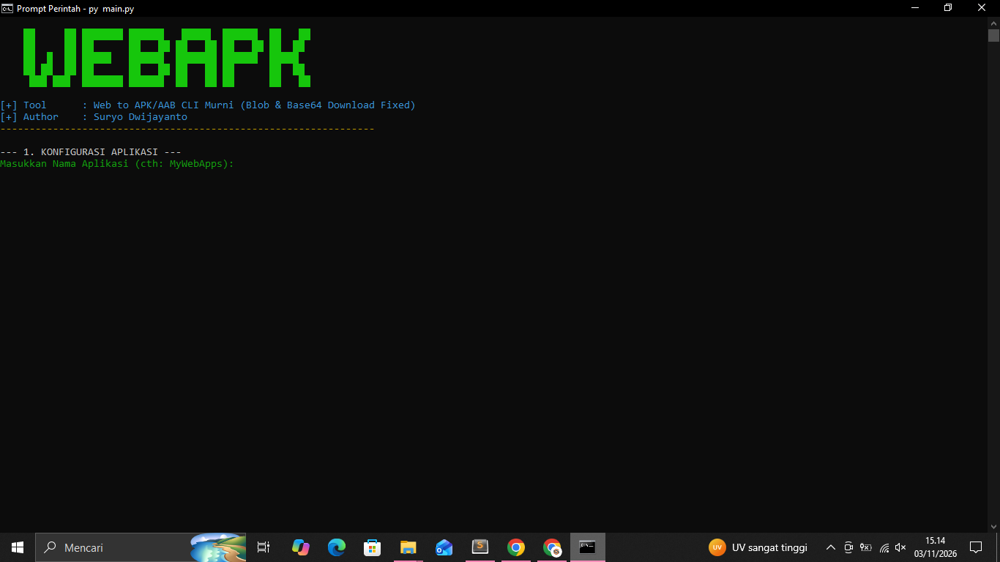
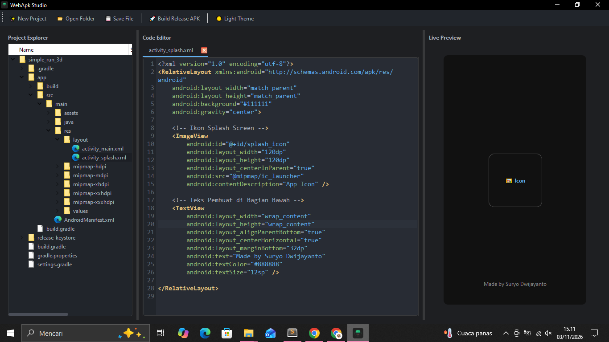

<h1>🚀 WebApk Generator Suite</h1>

<i>Professional Android Release Packaging & Development Service</i>

  
  
  

---

## 📦 About WebApk
This is a tool for creating Android release files in **.apk** and **.aab** formats. 
* The **.apk** file can be installed on Android smartphones.
* The **.aab** file is used for uploading to the Google Play Console/Play Store.

---

## 🛠️ Library & Tech Stack
* **SDK** (Software Development Kit)
* **JDK** (Java Development Kit)
* **Gradle** Build System

---

## 📊 Service Pricing & Complexity Overview
*Visualisasi perbandingan skala harga dan tingkat kerumitan layanan:*

| Service Tier | Complexity Level | Price Range (IDR) | Relative Scale |
| :--- | :---: | :---: | :--- |
| **1. Webview Asset/Url** | 🟢 Low | `70.000 - 200.000` | `█░░░░░░░░░` (20%) |
| **2. Native Simple (No DB)** | 🟡 Medium | `200.000 - 500.000` | `█████░░░░░` (50%) |
| **3. Native (Database/Fetch)** | 🔴 High | `500.000 - 50.000.000` | `██████████` (100%) |

---

## 🖼️ Application Previews

### 🔹 WebApk Terminal

### 🔹 WebApk Studio

### 🔹 Icon Overview

---

## 📬 Get in Touch
*Contact us for collaborations or to request application development services:*

| Channel | Contact Info | Direct Action |
|:---:|:---|:---:|
| 📧 **Email** | `iyortml@gmail.com` |  |
| 💬 **WhatsApp** | `+62 857-7275-7932` |  |
| 📸 **Instagram** | `@suryodwijayanto` |  |

---

> **📌 Note:**
> We do not release or distribute the Terminal or Studio applications publicly; we are an Android application development service!

  Regards,  
  <b>Suryo Dwijayanto</b>

